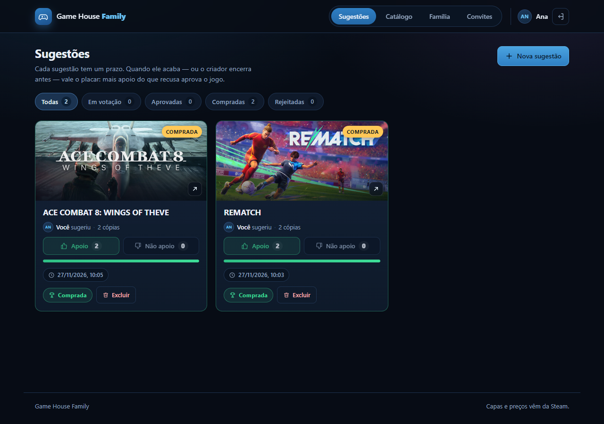
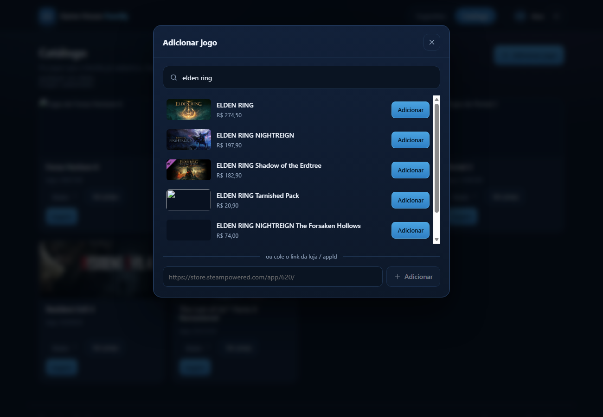

# Game House Family

Aplicação para a família de Steam **sugerir jogos, votar e acompanhar a compra**. Quem quer um jogo cria uma sugestão com prazo de votação; a família vota `APOIO` ou `NAO_APOIO`; ao fim do prazo a sugestão é aprovada ou rejeitada e, se aprovada, vira "comprada" quando alguém compra.

- **API:** Java 25, Spring Boot 4.1.1, Spring Data JPA, Bean Validation, PostgreSQL (Supabase), Maven.
- **Front-end:** React 19, TypeScript, Vite 8.
- **Testes:** JUnit 5 + Mockito (19 testes unitários, sem banco).

## Telas

| Login | Sugestões |
|---|---|
|  |  |

| Catálogo | Busca na Steam |
|---|---|
|  |  |

No celular a mesma interface vira uma coluna: 

## Como rodar

### 1. Banco (variáveis de ambiente)

| Variável | Obrigatória | Descrição |
|---|---|---|
| `SUPABASE_DB_URL` | sim | URL JDBC do Postgres (`jdbc:postgresql://...`) |
| `SUPABASE_DB_USERNAME` | sim | usuário do banco |
| `SUPABASE_DB_PASSWORD` | sim | senha do banco |
| `APP_BASE_URL` | não | URL pública da API (padrão `http://localhost:8081`). Usada no retorno do login Steam |
| `APP_FRONTEND_URL` | não | URL do front-end: libera CORS e recebe o redirect pós-login (use `http://localhost:5173` em dev) |
| `APP_ALLOWED_STEAM_IDS` | não | SteamID64 da família, separados por vírgula. Vazio = qualquer conta entra |
| `APP_DEV_LOGIN_ENABLED` | não | `true` liga `POST /auth/dev-login` (login falso para testes). **Nunca em produção** |
| `APP_DB_POOL_SIZE` | não | Conexões por instância (padrão `5`). Veja *Conexões* abaixo |

### 2. API

```bash
./mvnw test                # testes unitários (não precisam de banco)
./mvnw spring-boot:run     # sobe em http://localhost:8081
```

O projeto já vem com o **Maven Wrapper** (`mvnw`/`mvnw.cmd`), então não é preciso ter Maven instalado — só o JDK 25.

Para gerar o jar executável:

```bash
./mvnw package
java -jar target/game-house-family-1.0-SNAPSHOT.jar
```

### 3. Front-end

```bash
cd frontend
npm install
npm run dev      # http://localhost:5173
npm run build    # gera dist/ para publicar
```

O front fala com a API pela variável `VITE_API_URL` (padrão `http://localhost:8081`). Veja `frontend/.env.example`.

**Para o login (inclusive o falso) funcionar, suba a API com `APP_FRONTEND_URL=http://localhost:5173`** — é isso que libera o CORS e manda o usuário de volta para o front depois do login Steam.

## Login

- **Steam (OpenID 2.0):** no front, o botão "Entrar com a Steam" abre `GET /auth/steam/login`. A Steam autentica e volta em `/auth/steam/callback`, que cria/atualiza o usuário e abre uma sessão (cookie `HttpOnly`, `SameSite=Lax`). Nome e avatar vêm do perfil público.
- **Desenvolvimento:** com `APP_DEV_LOGIN_ENABLED=true`, `POST /auth/dev-login` com `{ "steamId": "...", "displayName": "..." }`. O front mostra esse atalho automaticamente em modo de desenvolvimento.

Todas as rotas, exceto `/`, `/error` e `/auth/steam/*`, exigem sessão (senão **401**).

## Endpoints

| Método | Rota | O que faz |
|---|---|---|
| GET | `/auth/steam/login` | Redireciona para o login da Steam |
| GET | `/auth/steam/callback` | Retorno da Steam; abre a sessão |
| GET | `/auth/me` | Usuário logado |
| POST | `/auth/logout` | Encerra a sessão |
| **GET** | **`/steam/search?q=`** | **Busca jogos por nome na loja da Steam (para não exigir o appId do usuário)** |
| POST | `/games` | Cadastra jogo pelo `steamAppId` (nome e capa vêm da Steam) |
| GET | `/games`, `/games/{id}` | Lista (ordem alfabética) / detalhe |
| PATCH | `/games/{id}` | Altera o nome |
| GET | `/games/{id}/price` | Preço atual na Steam (centavos, consultado na hora) |
| POST | `/suggestions` | Cria sugestão `{ gameId, copies, votingDays }` |
| GET | `/suggestions?status=` | Lista (filtro opcional por status) |
| GET | `/suggestions/{id}` | Detalhe com placar e o voto de quem está logado |
| PUT | `/suggestions/{id}/vote` | Vota ou troca o voto `{ "choice": "APOIO" \| "NAO_APOIO" }` |
| POST | `/suggestions/{id}/close` | Encerra a votação (aprova/rejeita) |
| POST | `/suggestions/{id}/purchase` | Marca sugestão aprovada como comprada |

### Formato de erro

Toda resposta de erro usa o **mesmo** formato — um único parser no front:

```json
{ "status": 409, "message": "Já existe uma sugestão em votação para este jogo", "fields": null }
```

Erro de validação preenche `fields`:

```json
{ "status": 400, "message": "Dados inválidos", "fields": { "copies": "O número de cópias deve ser maior que 0" } }
```

Códigos: `400` validação, `401` sem login, `403` sem permissão, `404` não encontrado, `405` método errado, `409` conflito de regra, `415` corpo não-JSON, `500` erro inesperado, `502` Steam indisponível.

## Regras de negócio

- **RN-04/09** Só uma sugestão `EM_VOTACAO` por jogo (checada no Service e garantida por índice único parcial no banco). O histórico é livre.
- **RN-07** `copies >= 1`. **RN-10/11** Prazo de 1 a 30 dias, escolhido pelo criador.
- **RN-12/13** Um voto por usuário por sugestão; pode trocar enquanto a votação está aberta.
- **RN-14** Ao encerrar: `APOIO > NAO_APOIO` → `APROVADA`; empate ou nenhum voto → `REJEITADA`.
- **RN-15** O criador pode encerrar a qualquer momento; os demais só depois do prazo. Um agendador encerra automaticamente, a cada minuto, o que já passou do prazo.
- **RN-16** Só sugestão `APROVADA` vira `COMPRADA`; qualquer membro logado pode marcar.
- **RN-17** Se `APP_ALLOWED_STEAM_IDS` estiver preenchida, só essas contas entram.

Fluxo de status: `EM_VOTACAO → APROVADA → COMPRADA` ou `EM_VOTACAO → REJEITADA`.

## Estrutura

```
src/main/java/.../
  controller/   HTTP
  service/      regras de negócio (+ Steam, OpenID, agendador)
  repository/   Spring Data JPA
  model/        entidades (sem setters: mudança de estado só por método de regra)
  dto/          o que entra e sai da API (records), inclui ApiError
  config/       sessão, login, CORS, HTTP clients da Steam
  exception/    exceções de negócio + GlobalExceptionHandler

frontend/src/
  api.ts        cliente tipado da API (um parser de erro só)
  auth.tsx      sessão do usuário (contexto)
  format.ts     preço em BRL, prazos, datas
  components/   Header, SuggestionCard, CatalogView, modais, toasts...
  styles.css    tema escuro, responsivo
```

## Banco de dados

- `spring.jpa.hibernate.ddl-auto=update` (cria/ajusta tabelas; não renomeia nem apaga colunas).
- Tabelas: `game`, `users` (`user` é reservada no Postgres), `suggestion`, `vote`.
- `data.sql` cria o índice único parcial `ux_suggestion_one_active_per_game` (1 sugestão `EM_VOTACAO` por jogo).
- `vote` tem unique `(user_id, suggestion_id)`.
- `game.image_url` guarda a capa que a Steam devolveu no cadastro. Jogos antigos sem esse valor usam a URL montada como fallback.

### Conexões (atenção com o Supabase)

O **pooler de sessão** do Supabase (porta 5432) limita o **total** de clientes (15 no plano free). O pool padrão do Hikari é 10 por instância, então duas instâncias — ou um restart enquanto as conexões antigas não expiram — estouram o limite com `FATAL: (EMAXCONNSESSION) max clients reached`. Por isso `APP_DB_POOL_SIZE=5` por padrão. Se for rodar mais de uma instância, use o pooler de transação (porta 6543) ou diminua o valor.

## Limitações conhecidas

- **CSRF:** a sessão é cookie `HttpOnly` + `SameSite=Lax`. Isso já bloqueia POST/PUT/PATCH vindos de outro site; todas as rotas que mudam estado são POST/PUT/PATCH. Se o front for servido de um domínio diferente da API, será preciso `SameSite=None; Secure` e revisar CSRF.
- **Sessão em memória:** reiniciar a API desloga todos; não escala para várias instâncias sem sessão compartilhada.
- **Sem DELETE de jogo/sugestão:** as sugestões referenciam o jogo. Erro de cadastro precisa ser corrigido no banco.
- **`GET /suggestions` faz N+1:** duas contagens por item + carregamento de usuário/jogo. Irrelevante para uma família, mas não escala para centenas de sugestões.
- **`GET /games/{id}/price` chama a Steam a cada clique** (5–10 s). A grade do catálogo pede o preço só quando o usuário clica em "Ver preço".
- Quórum fixo (maioria simples). Quórum configurável, comentários e compras parciais ficam para o futuro.
