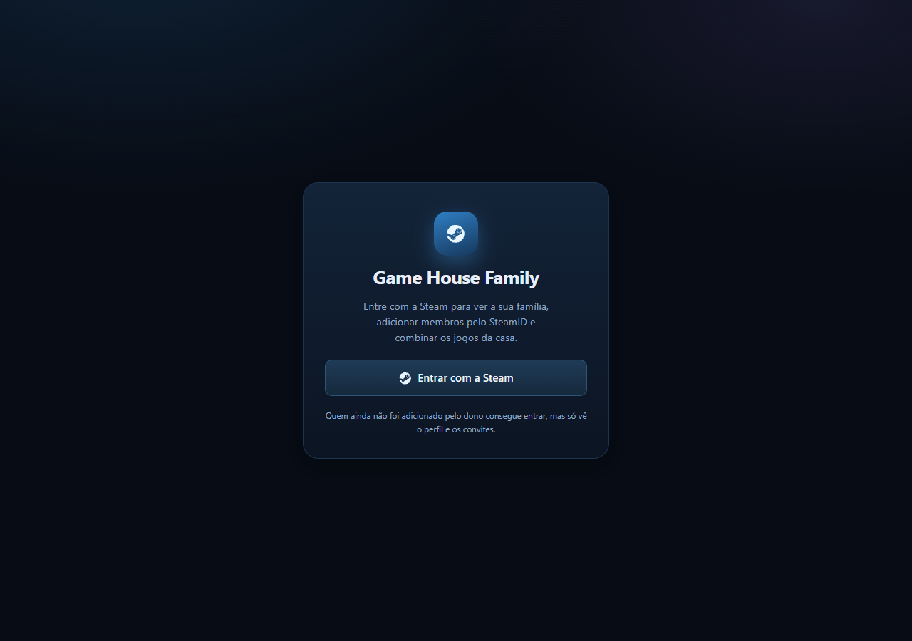
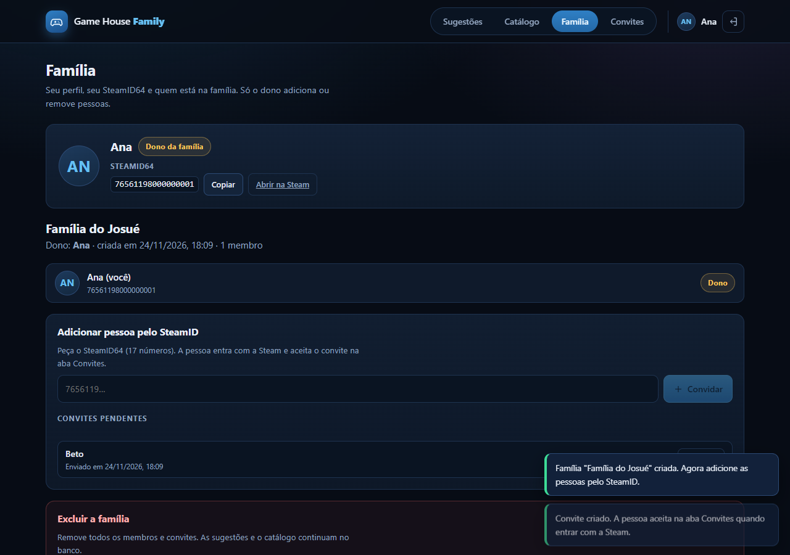
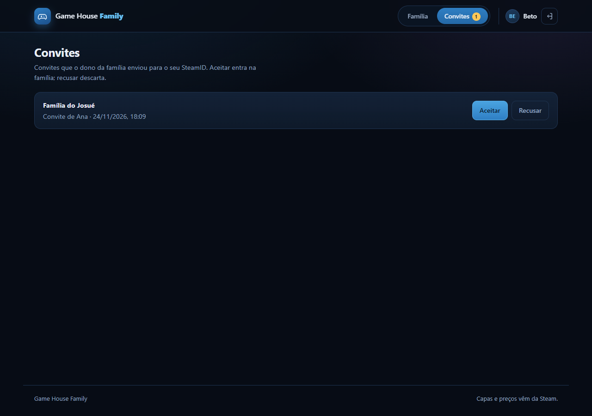
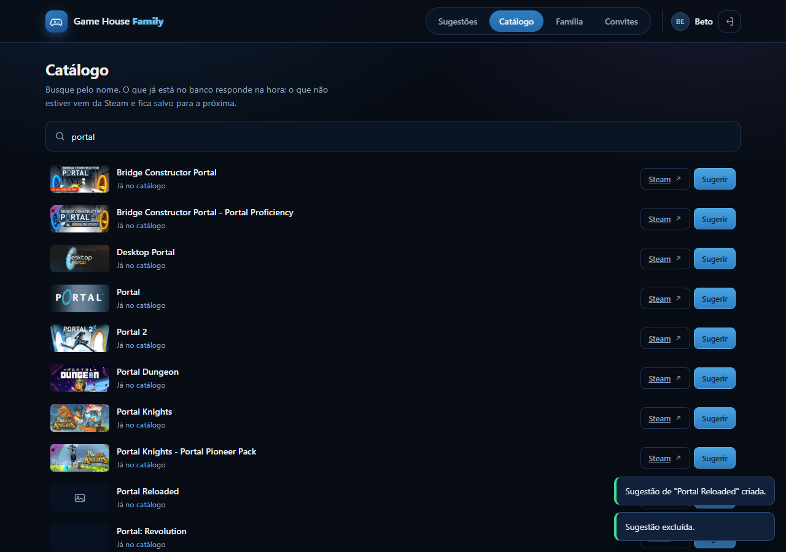
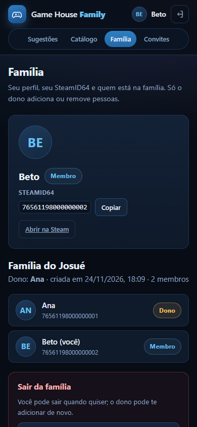

# Game House Family

Aplicação para a família de Steam **entrar com a Steam, organizar quem faz parte da família e combinar os jogos da casa**: o dono adiciona as pessoas pelo SteamID64, cada pessoa aceita o convite e a família sugere, vota e acompanha a compra dos jogos.

- **API:** Java 25, Spring Boot 4.1.1, Spring Data JPA, Bean Validation, PostgreSQL (Supabase), Maven.
- **Front-end:** React 19, TypeScript, Vite 8.
- **Testes:** JUnit 5 + Mockito (35 testes unitários, sem banco).

> **Sobre "família da Steam":** a Steam não oferece API pública para ler a sua Steam Family nem para convidar membros. O login OpenID devolve apenas o SteamID64. Por isso a família é **gerenciada pelo app**: o dono cria a família uma vez, adiciona as pessoas pelo SteamID64 e o app guarda quem é dono e quem é membro. O vínculo é feito pelo SteamID de cada conta que entra com a Steam — não é possível importar nem gerenciar a família oficial da Steam automaticamente.

## Telas

| Login | Família (dono) |
|---|---|
|  |  |

| Sugestões | Convites |
|---|---|
|  |  |

| Catálogo com busca | Nova sugestão |
|---|---|
|  |  |

No celular a mesma interface vira uma coluna: 

## Como rodar

### 1. Banco (variáveis de ambiente)

| Variável | Obrigatória | Descrição |
|---|---|---|
| `SUPABASE_DB_URL` | sim | URL JDBC do Postgres (`jdbc:postgresql://...`) |
| `SUPABASE_DB_USERNAME` | sim | usuário do banco |
| `SUPABASE_DB_PASSWORD` | sim | senha do banco |
| `APP_BASE_URL` | não | URL pública da API (padrão `http://localhost:8081`). Usada no retorno do login Steam |
| `APP_FRONTEND_URL` | não | URL do front-end: libera o CORS e recebe o usuário depois do login Steam (padrão `http://localhost:5173`). **Em produção, defina a URL real** |
| `APP_FAMILY_OWNER_STEAM_ID` | não | SteamID64 da conta que pode criar a família. Vazio = a primeira conta que criar vira dona. **Recomendado definir o seu** |
| `APP_DEV_LOGIN_ENABLED` | não | `true` liga `POST /auth/dev-login` (login falso para testes). **Nunca em produção** |
| `APP_DB_POOL_SIZE` | não | Conexões por instância (padrão `5`). Veja *Conexões* abaixo |

### 2. API

```bash
./mvnw test                # testes unitários (não precisam de banco)
./mvnw spring-boot:run     # sobe em http://localhost:8081
```

O projeto já vem com o **Maven Wrapper** (`mvnw`/`mvnw.cmd`), então não é preciso ter Maven instalado — só o JDK 25.

Para gerar o jar executável:

```bash
./mvnw package
java -jar target/game-house-family-1.0-SNAPSHOT.jar
```

### 3. Front-end

```bash
cd frontend
npm install
npm run dev      # http://localhost:5173
npm run build    # gera dist/ para publicar
```

O front fala com a API pela variável `VITE_API_URL` (padrão `http://localhost:8081`). Veja `frontend/.env.example`.

**Em desenvolvimento não precisa configurar nada:** a API já libera CORS para `http://localhost:5173` (e `127.0.0.1:5173`) e devolve o usuário para lá depois do login Steam. Em produção, defina `APP_FRONTEND_URL` com a URL real do front — senão o CORS e o retorno do login vão apontar para o endereço local.

## Login

- **Só Steam (OpenID 2.0):** a tela de login tem um botão só. Ele abre `GET /auth/steam/login`; a Steam autentica e volta em `/auth/steam/callback`, que cria/atualiza o usuário, abre uma sessão (cookie `HttpOnly`, `SameSite=Lax`) e **redireciona para `APP_FRONTEND_URL`**. Nome e avatar vêm do perfil público; se o perfil não puder ser lido, o login continua com o nome "Jogador XXXX" e o motivo vai para o log.
- **Desenvolvimento:** com `APP_DEV_LOGIN_ENABLED=true`, `POST /auth/dev-login` com `{ "steamId": "...", "displayName": "..." }`. O front **não** mostra mais esse atalho: ele existia como um formulário de nome/ID que parecia um login paralelo.

Depois do login, `GET /auth/me` devolve o usuário e a família dele (`familyId`, `familyName`, `familyRole`). Se `familyId` vier nulo, a pessoa ainda não entrou em nenhuma família.

## Família

1. **Criar:** a primeira conta que criar a família vira **dona** (`DONO`). O app aceita **uma família só** — a criação seguinte responde `409`. Se `APP_FAMILY_OWNER_STEAM_ID` estiver definido, só aquela conta pode criar.
2. **Adicionar:** o dono copia o próprio SteamID64 no perfil e adiciona as pessoas pelo SteamID64 (17 números). O convite nasce **PENDENTE**.
3. **Aceitar:** a pessoa entra com a Steam, vê o número no badge da aba **Convites** e aceita (ou recusa). Só então vira membro.
4. **Um por pessoa:** o banco tem `unique (user_id)` em `family_member`, então ninguém consegue entrar em duas famílias nem aceitando dois convites ao mesmo tempo.
5. **Sair/remover:** o membro pode sair; o dono pode remover qualquer um (menos a si mesmo) e excluir a família. O dono **não** pode sair sozinho — precisa excluir a família.
6. **Acesso:** quem está logado mas não é membro só vê o perfil/onboarding e os convites. `/games`, `/games/search`, `/suggestions` e `/steam/*` respondem `403` para não-membros.

## Endpoints

| Método | Rota | O que faz |
|---|---|---|
| GET | `/auth/steam/login` | Redireciona para o login da Steam |
| GET | `/auth/steam/callback` | Retorno da Steam; abre a sessão |
| GET | `/auth/me` | Usuário logado + resumo da família |
| POST | `/auth/logout` | Encerra a sessão |
| GET | `/family` | Família do usuário com membros (`204` se não tem) |
| POST | `/family` | Cria a família `{ name }` (uma só) |
| DELETE | `/family` | Exclui a família (dono) |
| POST | `/family/leave` | Sai da família (membro) |
| POST | `/family/invites` | Convida por SteamID64 `{ steamId }` (dono) |
| GET | `/family/invites` | Convites pendentes enviados pela família (dono) |
| DELETE | `/family/invites/{id}` | Cancela um convite (dono) |
| DELETE | `/family/members/{userId}` | Remove um membro (dono) |
| GET | `/invites` | Convites pendentes recebidos pelo meu SteamID |
| POST | `/invites/{id}/accept` | Aceita o convite e entra na família |
| POST | `/invites/{id}/decline` | Recusa o convite |
| **GET** | **`/games/search?q=`** | **Busca no banco primeiro e, se faltar, na Steam (salvando o resultado)** |
| POST | `/games` | Cadastra jogo pelo `steamAppId` (nome e capa vêm da Steam) |
| GET | `/games`, `/games/{id}` | Lista (ordem alfabética) / detalhe |
| PATCH | `/games/{id}` | Altera o nome |
| GET | `/games/{id}/price` | Preço atual na Steam (centavos, consultado na hora) |
| POST | `/suggestions` | Cria sugestão `{ gameId, copies, votingDays }` |
| GET | `/suggestions?status=` | Lista (filtro opcional por status) |
| GET | `/suggestions/{id}` | Detalhe com placar e o voto de quem está logado |
| PUT | `/suggestions/{id}/vote` | Vota ou troca o voto `{ "choice": "APOIO" \| "NAO_APOIO" }` |
| POST | `/suggestions/{id}/close` | Encerra a votação (aprova/rejeita) |
| POST | `/suggestions/{id}/purchase` | Marca sugestão aprovada como comprada |
| **DELETE** | **`/suggestions/{id}`** | **Exclui a sugestão e os votos (criador ou dono)** |

### Formato de erro

Toda resposta de erro usa o **mesmo** formato — um único parser no front:

```json
{ "status": 409, "message": "Já existe uma sugestão em votação para este jogo", "fields": null }
```

Erro de validação preenche `fields`:

```json
{ "status": 400, "message": "Dados inválidos", "fields": { "copies": "O número de cópias deve ser maior que 0" } }
```

Códigos: `400` validação, `401` sem login, `403` sem permissão, `404` não encontrado, `405` método errado, `409` conflito de regra, `415` corpo não-JSON, `500` erro inesperado, `502` Steam indisponível.

## Regras de negócio

- **RF-01** Existe no máximo uma família no app; quem cria vira `DONO`.
- **RF-02** Só o dono convida, cancela convite e remove membros. O dono não pode sair sozinho.
- **RF-03** Convite é feito pelo SteamID64 (17 números) e só vira membro depois de aceito.
- **RF-04** Uma pessoa participa de uma família por vez (garantido por `unique (user_id)`).
- **RF-05** Sem família, a pessoa só acessa `/auth/*`, `/family`, `/invites` e `/auth/me`.
- **RN-04/09** Só uma sugestão `EM_VOTACAO` por jogo (checada no Service e garantida por índice único parcial no banco). O histórico é livre.
- **RN-07** `copies >= 1`. **RN-10/11** Prazo de 1 a 30 dias, escolhido pelo criador.
- **RN-12/13** Um voto por usuário por sugestão; pode trocar enquanto a votação está aberta.
- **RN-14** Ao encerrar: `APOIO > NAO_APOIO` → `APROVADA`; empate ou nenhum voto → `REJEITADA`.
- **RN-15** O criador pode encerrar a qualquer momento; os demais só depois do prazo. Um agendador encerra automaticamente, a cada minuto, o que já passou do prazo.
- **RN-16** Só sugestão `APROVADA` vira `COMPRADA`; qualquer membro logado pode marcar.
- **RN-18** O criador ou o dono da família pode excluir a sugestão (a exclusão apaga os votos antes).
- **RN-19** A busca de jogos consulta primeiro o banco (`ILIKE` no nome). Se faltar resultado, consulta a Steam e **salva** o que veio, para a próxima busca ser local.

Fluxo de status: `EM_VOTACAO → APROVADA → COMPRADA` ou `EM_VOTACAO → REJEITADA`.

## Estrutura

```
src/main/java/.../
  controller/   HTTP (auth, família, jogos, sugestões, votos)
  service/      regras de negócio (+ família, Steam, OpenID, agendador)
  repository/   Spring Data JPA
  model/        entidades (sem setters: mudança de estado só por método de regra)
  dto/          o que entra e sai da API (records), inclui ApiError
  config/       sessão, login, CORS, HTTP clients da Steam, FamilyInterceptor
  exception/    exceções de negócio + GlobalExceptionHandler

frontend/src/
  api.ts        cliente tipado da API (um parser de erro só)
  auth.tsx      sessão do usuário (contexto)
  format.ts     preço em BRL, prazos, datas
  useGameSearch.ts  busca com debounce e descarte de resposta velha
  components/   Header, FamilyView, InvitesView, CatalogView, modais, toasts...
  styles.css    tema escuro, responsivo
```

## Banco de dados

- `spring.jpa.hibernate.ddl-auto=update` (cria/ajusta tabelas; não renomeia nem apaga colunas).
- Tabelas: `game`, `users` (`user` é reservada no Postgres), `suggestion`, `vote`, `family`, `family_member`, `family_invite`.
- `family_member` tem `unique (user_id)` — é o que garante "uma família por pessoa".
- `data.sql` cria o índice único parcial `ux_suggestion_one_active_per_game` (1 sugestão `EM_VOTACAO` por jogo).
- `vote` tem unique `(user_id, suggestion_id)`.
- `game.image_url` guarda a capa que a Steam devolveu no cadastro. Jogos que entram pela busca salvam a capa 460x215 montada a partir da miniatura devolvida pela busca.
- **Busca com cache:** todo resultado vindo da Steam é gravado em `game`; o catálogo passa a ser também o cache local. Com o tempo ele cresce — ainda não existe DELETE de jogo.

### Conexões (atenção com o Supabase)

O **pooler de sessão** do Supabase (porta 5432) limita o **total** de clientes (15 no plano free). O pool padrão do Hikari é 10 por instância, então duas instâncias — ou um restart enquanto as conexões antigas não expiram — estouram o limite com `FATAL: (EMAXCONNSESSION) max clients reached`. Por isso `APP_DB_POOL_SIZE=5` por padrão. Se for rodar mais de uma instância, use o pooler de transação (porta 6543) ou diminua o valor.

## Limitações conhecidas

- **Sem API de família da Steam:** a Steam não expõe a Steam Family por API pública. O app gerencia a própria família, vinculada pelo SteamID64. Não é possível detectar/entrar na família oficial da Steam automaticamente.
- **Uma família por instalação:** o app é de uma família só; os jogos/sugestões não são separados por família. Para atender várias famílias no mesmo banco, seria preciso acrescentar `family_id` em `game` e `suggestion` e filtrar tudo.
- **CSRF:** a sessão é cookie `HttpOnly` + `SameSite=Lax`. Isso já bloqueia POST/PUT/PATCH/DELETE vindos de outro site. Se o front for servido de um domínio diferente da API, será preciso `SameSite=None; Secure` e revisar CSRF.
- **Sessão em memória:** reiniciar a API desloga todos; não escala para várias instâncias sem sessão compartilhada.
- **Sem DELETE de jogo:** o catálogo/cache só cresce. As sugestões podem ser excluídas; o jogo não.
- **`GET /suggestions` faz N+1:** duas contagens por item + carregamento de usuário/jogo. Irrelevante para uma família, mas não escala para centenas de sugestões.
- **`GET /games/{id}/price` chama a Steam a cada clique** (5–10 s). A grade do catálogo pede o preço só quando o usuário clica em "Ver preço".
